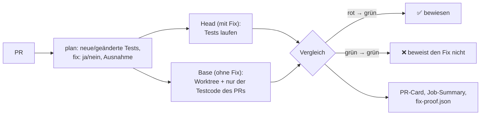

# 🧪 Fix-Proof: Jeder Fix wird bewiesen

> **Kurz:** Für jeden neuen oder geänderten Test eines Pull Requests prüft die CI zwei Dinge:
> **ohne** den Fix (Base-Commit, nur der Testcode des PRs darübergelegt) muss er **rot** sein,
> **mit** dem Fix (PR-Head) muss er **grün** sein. Ein `fix:`-PR, bei dem kein Test diese Probe
> besteht, ist rot. Das Ergebnis steht als harte Telemetrie auf der PR-Card.

English summary: [below](#english-summary).

---

## Warum das grundlegend ist

Ein Bugfix hat zwei Teile: die Änderung, die den Fehler behebt, und den Test, der beweist, dass
er behoben ist und behoben bleibt. Der zweite Teil ist der wertvollere. Die Änderung wirkt einmal.
Der Test läuft in **jedem künftigen CI-Lauf** mit, in jedem PR, auf jeder Plattform, solange es
das Projekt gibt. Kommt der Fehler mit einer späteren Änderung zurück, wird er rot, bevor ein
Mensch oder eine Bank etwas davon merkt.

Dieser Schutz besteht aber nur, **wenn der Test den Fehler tatsächlich fängt.** Ein Test, der
schon vor dem Fix grün war, schützt vor nichts: Er prüft etwas anderes als den Fehler. Ohne Probe
sieht man das einem Test nicht an. Er steht im Diff, er ist grün, und der Review hakt ab.

Genau das prüft Fix-Proof, und zwar **maschinell**:

| Ohne Fix-Proof | Mit Fix-Proof |
|---|---|
| „Regressionstest hinzugefügt“ ist eine Behauptung im PR-Text | rot → grün ist ein Lauf mit Protokoll in der CI |
| ein Test, der den Fehler verfehlt, fällt niemandem auf | er erscheint als 🟩→🟩 „beweist den Fix nicht“, der `fix:`-PR wird rot |
| Reviewer müssen den Test im Kopf gegen den alten Code ausführen | die CI führt ihn gegen den alten Code aus |
| KI-Agenten berichten Erfolg, der Bericht wird geglaubt | der Bericht wird gegen den Lauf geprüft; ein Agent kann „rot ohne Fix“ nicht vortäuschen |

Für GiroCrab gilt das besonders. Ein großer Teil des Codes wird mit KI-Agenten geschrieben
([KI-Transparenz](ai-transparency.md)), und Fehler im Bankabgleich, bei Kategorien, Salden oder
im iCloud-Abgleich betreffen echtes Geld. Agenten sind gut darin, plausible Tests zu schreiben,
und genauso gut darin, Tests zu schreiben, die am eigentlichen Fehler vorbeigehen. Fix-Proof
macht diesen Unterschied sichtbar, bei jedem Fix, für immer.

### Der Hebel

- **Einmal bewiesen, dauerhaft geschützt.** Jeder bewiesene Test wird Teil der Suite (heute über
  1.400 Rust-Tests im Core und die Swift-Suite der App) und läuft danach in jedem CI-Lauf mit.
- **Kein Mehraufwand für gute PRs.** Wer den Test ohnehin richtig schreibt, merkt nur ein ✅ auf
  der Card.
- **Fehler werden billiger.** Ein Fehler, den ein Test vor dem Merge fängt, kostet einen roten
  Check. Derselbe Fehler nach einem Release kostet ein Update, eine Fehlersuche ohne Testfall und
  Vertrauen.
- **Unabhängig davon, wer den Code schreibt.** Mensch, Agent oder beide: Die Probe ist dieselbe.
- **Nicht abschaltbar durch den PR selbst.** Ändert ein PR den Prüfer (`tools/fix_proof.py` oder
  `ci.yml`), zeigt die Card das Ergebnis an, wertet es aber nicht als Beleg (siehe unten).

---

## Wie es funktioniert



1. **Plan** (`tools/fix_proof.py plan`, ohne Build). Aus dem Diff zwischen Base und Head werden
   alle Testfunktionen gelesen, die neu sind oder deren Text sich geändert hat:
   * Rust: `#[test]`, `#[tokio::test]` (auch mit Argumenten) in `#[cfg(test)]`-Modulen, in
     Testdateien (`tests.rs`, `*_tests.rs`, `tests/`-Verzeichnisse, Module mit
     `#[cfg(test)] mod x;`) und Integrationstests unter `<crate>/tests/*.rs`.
   * Swift: `func test…()` in `XCTestCase`-Klassen (auch in Extensions) und `@Test`-Funktionen
     (Swift Testing) unter `GiroCrabApp/Tests/`.

   Ein PR gilt als Fix, wenn sein Titel mit `fix:` / `fix(<scope>):` beginnt (Conventional
   Commits, wie im Repo üblich).
2. **Head-Lauf.** Genau diese Tests laufen auf dem PR-Stand (`cargo test --exact …`,
   `swift test --filter …`).
3. **Base-Lauf.** Ein `git worktree` des Base-Commits bekommt **nur den Testcode** des PRs:
   * Rust: Testdateien werden übernommen. In Dateien, die Produktionscode und Tests enthalten,
     ersetzt ein kleiner Rust-Lexer nur die `#[cfg(test)]`-Einträge (Module, Hilfsfunktionen,
     `#[test]`-Funktionen) durch die Fassung des PRs. Der Produktionscode bleibt auf dem Stand
     **vor** dem Fix.
   * Kompiliert die Base so nicht, weil einzelne Tests eine API brauchen, die erst der Fix
     einführt, nimmt Fix-Proof genau die Dateien zurück, die der Compiler nennt, und baut erneut
     (bis zu vier Runden). Die Tests dieser Dateien zählen als schwacher Beweis, alle anderen
     bekommen weiter eine echte Antwort rot oder grün. Ein einziger Test mit neuer API kann so
     nicht die Probe des ganzen PRs entwerten.
   * Swift: die geänderten Dateien unter `GiroCrabApp/Tests/`. Ändert der PR auch den Core, baut
     die Base ihre eigenen Bindings (`build-xcframework.sh --macos-only`), sonst nutzt sie die
     des Heads.
4. **Vergleich** pro Test:

| Status | Bedeutung | zählt als Beweis |
|---|---|---|
| 🟥→🟩 **rot → grün** | Test schlägt ohne den Fix fehl und besteht mit ihm | ✅ stark |
| 🟧→🟩 **rot (ohne Fix nicht baubar) → grün** | der Test braucht eine API, die erst der Fix einführt; ohne den Fix kompiliert seine Datei nicht | 🟧 schwach |
| 🟧→🟩 **rot (Timeout) → grün** | ohne den Fix hängt der Lauf (z. B. Endlosschleife) | 🟧 schwach |
| 🟩→🟩 **grün → grün** | Test besteht auch ohne den Fix | ❌ beweist den Fix nicht |
| ❌ **auf dem Head rot** | Test scheitert mit dem Fix (fällt auch im normalen Testjob auf) | – |
| ⚪️ **nicht gelaufen** | z. B. `#[ignore]`, nur unter macOS übersetzt, Lauf abgebrochen | – |

5. **Urteil** für den PR (`fix-proof.json`, Job-Summary, PR-Card):

| Urteil | Wann | `fix:`-PR |
|---|---|---|
| ✅ Fix bewiesen | mindestens ein Test rot → grün | grün |
| 🟧 schwach belegt | nur „nicht baubar“ oder „Timeout“ | grün |
| ❌ nicht bewiesen | Tests vorhanden, aber keiner rot ohne den Fix | **rot** |
| ❌ ohne Test | kein neuer oder geänderter Test | **rot** |
| ⚪️ nicht gelaufen | Tests geplant, aber kein Ergebnis | **rot** |
| ⏭️ Ausnahme | `Fix-Proof: skip – <Grund>` im PR-Body | grün |
| ℹ️ / ➖ | kein `fix:`-PR: Ergebnis nur zur Information | grün |

Bei Feature-PRs läuft dieselbe Probe und landet auf der Card („Fix bewiesen“ gibt es auch dort,
wenn ein neuer Test altes Verhalten als falsch entlarvt), blockiert aber nie.

### Ausnahmen

Manche Fixes lassen sich nicht sinnvoll automatisch testen: ein Tippfehler in einem Log-Text,
Timing, das nur auf echter Bank-Hardware auftritt, ein reiner CI- oder Build-Fix. Dann steht im
PR-Body (oder als Trailer in einem Commit):

```
Fix-Proof: skip – <Grund, mindestens ein paar Worte>
```

Die Ausnahme ist sichtbar: Card und Job-Summary zeigen „⏭️ Ausnahme begründet“, der Grund steht
im PR. Ohne Grund gilt sie nicht.

### Warum ein eigener Cargo-Build für die Base

Cargo identifiziert ein Workspace-Mitglied über seinen Pfad **relativ** zum Workspace. Zwei
Worktrees desselben Repos sind für Cargo also derselbe Baustein, und in einem gemeinsamen
`target/`-Verzeichnis würde der Base-Lauf still das Testprogramm des Heads wiederverwenden. Das
ist bei der Entwicklung tatsächlich passiert: ein Test erschien als „grün → grün“, obwohl er ohne
den Fix gar nicht kompiliert. Fix-Proof gibt deshalb jeder Seite eine eigene Build-Einheit (eine
wirkungslose Profil-Einstellung pro Paket, `UNIT_VARIANT` in `tools/fix_proof.py`). Die
Abhängigkeiten bleiben geteilt und gecacht. Ein Test in `tools/test_fix_proof.py` hält das fest.

---

## Belege: echte Fixes aus der Historie

Vor der Einführung lief Fix-Proof lokal gegen drei bereits gemergte Fixes (Base = Stand vor dem
Fix, Head = der gemergte Commit; Befehl: `tools/fix_proof.py plan` + `run --lang rust`):

| PR | Tests | Ergebnis |
|---|---|---|
| #923 Amex: erster Abruf übernimmt die aktive Karte | 1 | 🟥→🟩 **bewiesen**: ohne den Fix schlägt `assert_eq!` fehl, mit ihm grün |
| #938 Spuerkeess über Enable Banking | 1 | 🟧 **schwach**: der Test ruft `needs_lean_request` auf, das erst der Fix einführt |
| #835 Sicherheits-Audit (Backup, Sperre, Parser, Überläufe) | 25 Rust | **18 bewiesen** (16 Assertions im Core, 2 im MCP-Adapter), 6 schwach (4 Dateien zurückgenommen, 1 neue Datei), **1 grün → grün** |

Der letzte Lauf zeigt beide Seiten:

* Ohne das dateiweise Zurücknehmen waren es bei #835 nur 2 starke und 23 schwache Beweise. Ein
  einziger Test, der eine neue API braucht, ließ das ganze Testprogramm der Base nicht
  kompilieren.
* `vault::backup::tests::checkpoint_succeeds_on_an_idle_vault` ist auch ohne den Fix grün. Der
  Test sichert vorhandenes Verhalten ab und ist als solcher sinnvoll, beweist aber nichts über den
  Fix. Genau diese Unterscheidung war vorher unsichtbar.
* Die 14 Swift-Tests desselben PRs liefen in diesem Linux-Container **nicht** (⚪️); in der CI laufen
  sie im macOS-Job.

## Phase 3: Mutation Testing

Fix-Proof beantwortet: *Fängt der neue Test den behobenen Fehler?* Mutation Testing fragt
weiter: *Würden die Tests einen **anderen** Fehler in genau diesem Code bemerken?*

Der Job `mutants` führt [cargo-mutants](https://mutants.rs) auf den Rust-Funktionen aus, die der
PR ändert (`--in-diff`). Jeder Mutant ist ein kleiner absichtlicher Fehler, etwa `||` statt `&&`,
`true` statt einer Bedingung, `*` statt `/`. Danach laufen die Core-Tests. Ein Mutant, den kein
Test bemerkt („überlebt“), zeigt auf eine Testlücke.

* Höchstens 12 Mutanten pro PR (je etwa eine Minute für Build und Testlauf); bei mehr wird eine
  Stichprobe genommen (`--shard 0/k`, round-robin), die Card sagt „Stichprobe“.
* **Nur Hinweis, nie Gate:** Manche Mutanten ändern nichts Beobachtbares (äquivalente
  Mutanten). Die Job-Summary listet überlebende Mutanten mit Datei und Zeile.
* Lokal: `python3 -I tools/fix_proof.py check --mutants` (verändert Dateien während des Laufs,
  cargo-mutants stellt sie wieder her; nicht abbrechen).

Beispiel aus der Entwicklung: Für den Fix aus #938 (Spuerkeess über Enable Banking) erzeugt
cargo-mutants 17 Mutanten in den geänderten Funktionen. Die sechs in den neuen Hilfsfunktionen
`is_spuerkeess` und `needs_lean_request` werden alle von den Tests erkannt (6/6, etwa 7 Minuten
lokal). Derselbe Fix zeigt auch die Grenze der Rot→Grün-Probe: Sein Test ruft
`needs_lean_request` auf, das es vor dem Fix nicht gab. Ohne den Fix kompiliert er nicht, das
Urteil ist deshalb „🟧 schwach belegt“.

---

## Lokal ausführen

```sh
# gegen upstream/main, Head = Arbeitsverzeichnis (auch ungespeicherte Änderungen)
python3 -I tools/fix_proof.py check --base upstream/main
python3 -I tools/fix_proof.py check --base upstream/main --swift     # macOS: auch Swift-Tests
python3 -I tools/fix_proof.py check --base upstream/main --mutants   # plus Mutation Testing

# einzelne Schritte, wie in der CI
python3 -I tools/fix_proof.py plan --base HEAD^1 --head HEAD --title "fix: …" --out plan.json
python3 -I tools/fix_proof.py run --plan plan.json --lang rust --out rust.json --keep   # Worktree behalten
python3 -I tools/fix_proof.py verdict --plan plan.json --results rust.json --enforce
```

`check` beendet sich mit Exit-Code 1, wenn ein `fix:`-PR nicht bewiesen ist; die Logs der Läufe
liegen im ausgegebenen Verzeichnis. Tests: `python3 -m unittest tools/test_fix_proof.py`
(enthält einen echten rot→grün-Lauf an einem Wegwerf-Workspace mit absichtlichem Fehler).

---

## In der CI

| Job (`ci.yml`) | Läuft bei | Macht |
|---|---|---|
| `fix-proof` | jedem PR | Plan, Rust-Probe, Urteil + Exit-Code; Artefakt `fix-proof` |
| `swift` (Schritte „Fix-Proof …“) | PRs mit neuen/geänderten Swift-Tests | Swift-Probe auf macOS; Artefakt `fix-proof-swift` |
| `fix-proof-verdict` | nur PRs mit Swift-Tests | fasst Rust und Swift zusammen, Urteil + Exit-Code |
| `mutants` | PRs mit geändertem Rust-Code | Mutation Testing, nur Hinweis; Artefakt `fix-proof-mutants` |

Die PR-Card (`ai-transparency.yml`) wird nach dem CI-Lauf neu gebaut (`workflow_run`) und liest
die Artefakte des Laufs für den PR-Head.

### Vertrauensmodell

* Die CI-Jobs laufen mit dem Code des PRs, wie alle Tests. Die Artefakte sind deshalb **Daten
  aus einer nicht vertrauenswürdigen Quelle**: Die Card übernimmt daraus nur feste Werte
  (Urteil, Status) und Zahlen, nie Text.
* Ändert ein PR `tools/fix_proof.py` oder `.github/workflows/ci.yml`, steht auf der Card
  „⚠️ PR ändert den Prüfer, kein Beleg“; das ✅ in Stufe 4 kommt dann nicht von Fix-Proof. Die
  Card selbst läuft immer mit dem Code des Base-Branches.
* Der Check `fix-proof` ist erst dann ein Gate, wenn er in den Branch-Regeln des Repos als
  „required“ eingetragen ist (Repository-Einstellung, nicht Teil dieses Codes).

---

## Grenzen (ehrlich)

* **Schwacher Beweis bei neuer API.** Braucht ein Test eine Funktion, die erst der Fix einführt,
  kompiliert er ohne den Fix nicht. Das ist rot, aber nicht dieselbe Aussage wie eine
  fehlschlagende Prüfung. Weil Fix-Proof dateiweise zurücknimmt, trifft das auch die anderen
  geänderten Tests **derselben Datei**. Stärker wird der Beweis, wenn der Test über eine
  bestehende Schnittstelle prüft (z. B. ein Integrationstest unter `tests/` oder ein Test der
  aufrufenden Funktion).
* **Nur Tests, deren eigener Text sich ändert,** werden geprüft. Ändert ein PR nur eine
  Test-Hilfsfunktion, wird kein Test ausgewählt.
* **Plattform:** Rust-Tests, die nur unter macOS übersetzt werden, laufen im Linux-Job nicht
  (⚪️). Swift-Tests laufen im macOS-Job.
* **Swift Testing mit Anzeigenamen** (`@Test("…")`) wird im Testprotokoll unter dem Anzeigenamen
  gemeldet und deshalb nicht zugeordnet (⚪️); `@Test func name()` funktioniert.
* **Unterstützte Struktur:** Hilfsmodule von Integrationstests (`tests/common/mod.rs`) und
  `#[cfg(test)]`-Elemente innerhalb von `impl`-Blöcken werden nicht einzeln übertragen; im
  Zweifel kompiliert die Base nicht, und der Test zählt als schwacher Beweis.
* **Was es nicht beweist:** dass der Fix vollständig ist oder keine anderen Fälle bricht. Dafür
  bleiben die ganze Testsuite, Mutation Testing und das Review.
* **Instabile Tests** (zeitabhängig, Reihenfolge) können ein falsches Rot ohne Fix liefern. Tests,
  die auf Timer warten, nutzen deshalb `#[tokio::test(start_paused = true)]` (siehe `CLAUDE.md`).

---

## English summary

**Fix-Proof proves every fix.** For each new or changed test in a pull request, CI runs the test
twice: on the base commit **without** the fix (a `git worktree` of the base with only the PR's
test code laid over it) it must be **red**, on the PR head **with** the fix it must be **green**.
Rust tests in mixed files are spliced in with a small lexer that replaces only `#[cfg(test)]`
items; Swift test files are copied over, and the base builds its own core bindings when the PR
changes the core. A `fix:` PR fails the `fix-proof` check unless at least one test is red → green
(a test that does not compile without the fix counts as weak proof), or the PR body says
`Fix-Proof: skip – <reason>`. Mutation testing (cargo-mutants on the changed Rust functions, at
most 12 mutants, report only) shows whether the tests would notice other bugs in the same code.

Why it matters: a regression test protects the project for as long as it exists, but only if it
actually catches the bug. A test that was already green before the fix protects nothing, and
nobody can tell by looking at it. Fix-Proof turns "added a regression test" from a claim into a
recorded run. This matters most where much of the code is written by AI agents: an agent can
claim a test proves a fix; it cannot fake the test being red without it. Results appear on the
AI Provenance card as hard telemetry (enums and counts only; a PR that changes the verifier is
shown but not counted). Tried on three merged fixes before it went live: in a security-audit PR (#835), 18 of 25 new Rust
tests were red without the fix (16 assertions in the core, 2 in the MCP adapter), 6 only failed to
compile without it, and 1 was green without the fix: it guards existing behaviour but proves nothing
about the fix. Run it locally with `python3 -I tools/fix_proof.py check --base upstream/main`.
